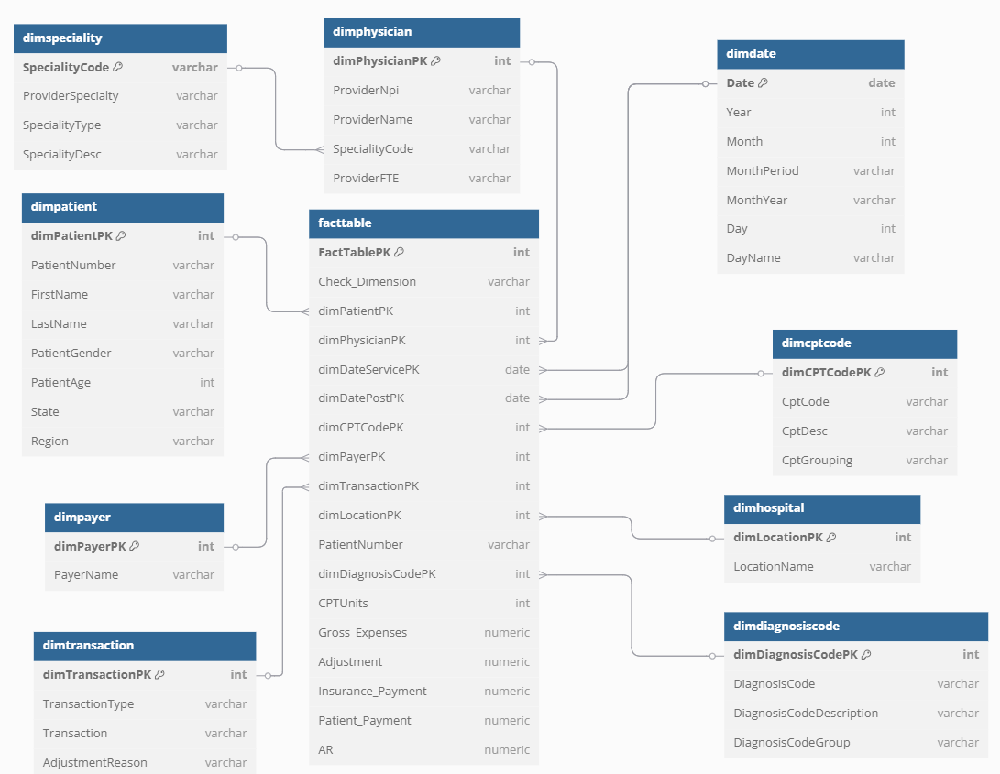

# 🏥 Healthcare Analytics | SQL, PostgreSQL & Python

An end-to-end healthcare data analytics project that transforms raw patient and medical claims data into meaningful business insights using **Python, PostgreSQL, SQL, and Jupyter Notebook**.

The project focuses on analyzing healthcare expenses, insurance coverage, patient payments, physician performance, hospital utilization, diagnosis patterns, and claim processing trends through **20 SQL-based business KPIs**.

---

## 📌 Project Overview

Healthcare organizations generate large volumes of patient, insurance, physician, and billing data. Analyzing this data helps identify cost patterns, understand insurance coverage, monitor claim payments, and evaluate operational performance.

This project implements a complete data analytics workflow:

- Clean and preprocess raw healthcare CSV datasets using Python.
- Perform exploratory data analysis (EDA) and data quality checks.
- Design a relational healthcare database using PostgreSQL.
- Create fact and dimension tables for analytical queries.
- Load cleaned datasets into PostgreSQL using Python automation.
- Solve 20 healthcare business problems using SQL.
- Execute SQL queries automatically using Python.
- Export analytical results into CSV files for further analysis.

## 🎯 Project Objectives

1. Build a structured healthcare database using PostgreSQL.
2. Improve raw data quality through Python-based preprocessing.
3. Analyze healthcare costs and insurance payment patterns.
4. Identify high-cost medical procedures and diagnosis groups.
5. Evaluate physician efficiency and hospital utilization.
6. Analyze patient out-of-pocket expenses across different states.
7. Detect multiple patient visits and delayed claim postings.
8. Automate SQL execution and CSV result generation.

---

## 🛠️ Tech Stack

| Category | Technology | Purpose |
|---|---|---|
| Programming | Python | Data processing and automation |
| Database | PostgreSQL | Healthcare data storage |
| Database GUI | pgAdmin 4 | Database management and SQL execution |
| Data Analysis | Pandas, NumPy | Data cleaning and exploration |
| Database Connectivity | Psycopg2 | Python–PostgreSQL integration |
| SQL Automation | SQL | Business KPI analysis |
| Notebook Environment | Jupyter Notebook | Interactive analysis |
| Visualization / Modeling | dbdiagram.io | Entity Relationship Diagram |

---

## 📁 Project Structure

```text
Health_Analytics_sql/
│
├── data/
│   ├── datasets/
│   │   └── Raw healthcare CSV files
│   │
│   └── outputs/
│       └── Cleaned healthcare CSV files
│
├── database/
│   ├── defining_tables.sql
│   └── Load_Data_Scripts.py
│
├── notebooks/
│   ├── 1_data_cleaning.ipynb
│   ├── 2_eda_analysis.ipynb
│   └── 3_sql_query_runner.ipynb
│
├── business_problems_outcomes/
│   ├── 01_top_cpt_costs.sql
│   ├── 02_avg_insurance_coverage.sql
│   ├── 03_insurance_vs_oop_ratio.sql
│   ├── 04_patients_without_insurance.sql
│   ├── 05_payers_most_claims_least_payment.sql
│   ├── 06_avg_patient_payment_by_state.sql
│   ├── 07_avg_claim_cost_by_gender.sql
│   ├── 08_top_states_by_oop_percent.sql
│   ├── 09_readmission_detection.sql
│   ├── 10_monthly_claim_trend.sql
│   ├── 11_physician_cost_efficiency.sql
│   ├── 12_claim_volume_by_specialty.sql
│   ├── 13_top_expensive_specialties.sql
│   ├── 14_diagnosis_claim_volume_avg_ar.sql
│   ├── 15_top_diagnosis_by_highest_ar.sql
│   ├── 16_monthly_claims_payout_trend.sql
│   ├── 17_top_hospitals_by_patients.sql
│   ├── 18_delayed_postings_count.sql
│   ├── 19_avg_cpt_units_by_grouping.sql
│   └── 20_diagnosis_with_most_adjustments.sql
│
├── outputs/
│   └── csvs/
│       └── SQL query result CSV files
│
├── diagrams/
│   └── ERD_Health_Analytics.png
│
└── README.md
```

---

## 🗃️ Database Design

The project uses a relational healthcare data warehouse model with one central fact table and nine dimension tables.

### Entity Relationship Diagram (ERD)

The ERD represents the relationships between healthcare claims, patients, physicians, hospitals, insurance payers, procedures, and diagnosis information.



*ERD designed using dbdiagram.io.*

### Fact Table

**`facttable`**

Stores healthcare claim and billing transactions.

Important columns:

| Column | Description |
|---|---|
| FactTablePK | Unique fact record identifier |
| dimPatientPK | Patient dimension reference |
| dimPhysicianPK | Physician dimension reference |
| dimDateServicePK | Service date |
| dimDatePostPK | Claim posting date |
| dimCPTCodePK | Procedure code reference |
| dimPayerPK | Insurance payer reference |
| dimTransactionPK | Transaction reference |
| dimLocationPK | Hospital/location reference |
| dimDiagnosisCodePK | Diagnosis reference |
| CPTUnits | Number of procedure units |
| Gross_Expenses | Total gross expenses |
| Adjustment | Financial adjustment |
| Insurance_Payment | Insurance payment amount |
| Patient_Payment | Patient payment amount |
| AR | Accounts receivable |

### Dimension Tables

| Table | Description |
|---|---|
| `dimpatient` | Patient demographics, age, gender, location, and other attributes |
| `dimphysician` | Physician details, NPI, specialty code, and FTE |
| `dimspeciality` | Medical specialty classifications and descriptions |
| `dimhospital` | Hospital and healthcare location information |
| `dimpayer` | Insurance payer information |
| `dimcptcode` | CPT procedure codes, descriptions, and groupings |
| `dimdiagnosiscode` | Diagnosis codes, descriptions, and categories |
| `dimdate` | Calendar information including year, month, and day |
| `dimtransaction` | Transaction types and adjustment reasons |

---

## 🔄 Project Workflow

The project follows an end-to-end data processing and analytics pipeline.

### Step 1: Data Cleaning

**Notebook:** `notebooks/1_data_cleaning.ipynb`

Raw CSV datasets are processed using Python and Pandas.

Operations performed:

- Load raw CSV files from `data/datasets/`.
- Standardize column names.
- Remove duplicate records.
- Handle missing values.
- Correct invalid date formats.
- Handle numeric anomalies such as `#NUM!` and `#DIV/0!`.
- Convert date columns into PostgreSQL-compatible formats.
- Export cleaned datasets.

**Output:** `data/outputs/`

### Step 2: Exploratory Data Analysis (EDA)

**Notebook:** `notebooks/2_eda_analysis.ipynb`

Exploratory analysis is performed to understand data quality and identify inconsistencies.

Analysis includes:

- Missing-value analysis.
- Duplicate record identification.
- Unique identifier validation.
- Patient demographic distributions.
- Gender and geographical distribution.
- Payer and physician data exploration.
- Data consistency checks across healthcare entities.

### Step 3: Database Creation and Data Loading

**Schema:** `database/defining_tables.sql`

The SQL script defines the healthcare database structure, including:

- One fact table.
- Nine dimension tables.
- Primary keys.
- Appropriate column data types.

**Data Loader:** `database/Load_Data_Scripts.py`

Python and Psycopg2 are used to:

1. Connect to PostgreSQL.
2. Create the database if configured to do so, or connect to the existing database.
3. Execute the table creation SQL script.
4. Locate cleaned CSV files.
5. Load CSV data into the corresponding PostgreSQL tables.
6. Handle database transaction errors.
7. Commit successfully loaded records.

**Database Name:** `Health_DataBase`

### Step 4: SQL Business Problem Solving

A total of 20 SQL queries are developed to answer healthcare business questions.

Each query focuses on a specific analytical objective using SQL operations such as:

- SELECT and WHERE
- GROUP BY and HAVING
- ORDER BY
- Aggregate functions
- JOIN operations
- Subqueries
- Date-based analysis
- Conditional calculations

### Step 5: SQL Automation and CSV Export

**Notebook:** `notebooks/3_sql_query_runner.ipynb`

Python automates the execution of SQL scripts.

Workflow:

1. Connect to PostgreSQL.
2. Read SQL files from `business_problems_outcomes/`.
3. Execute queries sequentially.
4. Convert query results into Pandas DataFrames.
5. Export results as CSV files.
6. Display execution status.

**Output Directory:** `outputs/csvs/`

---

## 📊 20 Healthcare Business KPIs

The following business problems are analyzed using SQL.

| No. | Business KPI | Analytical Objective |
|---:|---|---|
| 01 | Top CPT Codes by Total Expenses | Identify high-cost medical procedures and their total expenses. |
| 02 | Average Insurance Payment by Payer | Compare average insurance payments and coverage percentages across payers. |
| 03 | Insurance vs Out-of-Pocket Ratio | Understand the distribution of expenses between insurers and patients. |
| 04 | Patients Without Insurance Payment | Identify claims with zero insurance payments and analyze patient financial responsibility. |
| 05 | Payers with Most Claims but Least Payment | Identify high-volume payers with relatively low insurance payments. |
| 06 | Average Patient Payment by State | Compare average out-of-pocket payments across geographical regions. |
| 07 | Average Claim Cost by Gender | Analyze differences in average claim expenses across gender groups. |
| 08 | Top 5 States by Out-of-Pocket Percentage | Identify states with the highest patient payment burden. |
| 09 | Readmission Detection | Identify patients with multiple recorded hospital visits. |
| 10 | Monthly Claim Trend | Analyze monthly claim volumes and expense trends. |
| 11 | Physician Cost Efficiency | Evaluate physician-level costs relative to patients treated. |
| 12 | Claim Volume by Specialty | Understand claim distribution across medical specialties. |
| 13 | Top 5 Expensive Specialties | Identify medical specialties with the highest healthcare expenses. |
| 14 | Diagnosis Groups by Claim Volume and Average AR | Compare diagnosis-related claim volumes and accounts receivable. |
| 15 | Top 10 Diagnoses by Highest AR | Identify diagnosis categories associated with high accounts receivable. |
| 16 | Monthly Claims and Payout Trend | Analyze monthly claim volumes and insurance/patient payout trends. |
| 17 | Hospitals with Most Patients | Rank hospitals by patient volume and associated expenses. |
| 18 | Delayed Claim Postings | Identify claims posted after their service dates. |
| 19 | Average CPT Units by Procedure Group | Analyze average procedure units across CPT groupings. |
| 20 | Diagnosis with Most Adjustments | Identify diagnoses associated with the highest financial adjustments. |

### Business Analysis Categories

| Category | KPIs |
|---|---|
| Healthcare Cost Analysis | 01, 03, 07, 13 |
| Insurance and Payer Analysis | 02, 04, 05, 06, 08 |
| Patient and Hospital Analysis | 09, 17 |
| Physician and Specialty Analysis | 11, 12 |
| Diagnosis and Billing Analysis | 14, 15, 20 |
| Time and Operational Analysis | 10, 16, 18, 19 |

---

## ⚙️ Installation and Setup

### Prerequisites

Install the following before running the project:

- Python 3.x
- PostgreSQL
- pgAdmin 4
- Jupyter Notebook
- Git

### 1. Clone the Repository

```bash
git clone https://github.com/suhas2357/Health_Analytics_sql.git

cd Health_Analytics_sql
```

### 2. Create a Virtual Environment

```bash
python -m venv venv
```

Activate it on Windows:

```powershell
venv\Scripts\activate
```

### 3. Install Dependencies

```bash
pip install pandas numpy psycopg2-binary sqlalchemy jupyter notebook openpyxl
```

### 4. Configure PostgreSQL

Create or configure the PostgreSQL database:

```sql
CREATE DATABASE "Health_DataBase";
```

Update the PostgreSQL connection settings in the Python scripts:

```python
host="127.0.0.1",
port=5432,
dbname="Health_DataBase",
user="postgres",
password="YOUR_POSTGRES_PASSWORD"
```

Use your own PostgreSQL credentials. Do not upload passwords or other secrets to GitHub.

### 5. Create Database Tables

Execute:

```bash
python ./database/Load_Data_Scripts.py
```

The loader should execute `defining_tables.sql` before importing CSV files if automatic schema creation is enabled.

Alternatively, execute `database/defining_tables.sql` in pgAdmin before running the loader.

### 6. Run Data Cleaning

Launch Jupyter Notebook:

```bash
jupyter notebook
```

Open:

```text
notebooks/1_data_cleaning.ipynb
```

Run the notebook cells to generate cleaned CSV files in `data/outputs/`.

### 7. Perform Exploratory Data Analysis

Open:

```text
notebooks/2_eda_analysis.ipynb
```

Execute the notebook cells to explore the cleaned datasets and perform data quality checks.

### 8. Execute SQL Business Queries

Open:

```text
notebooks/3_sql_query_runner.ipynb
```

Execute the notebook to run the 20 SQL scripts and export their results.

Alternatively, execute individual `.sql` files using PostgreSQL Query Tool in pgAdmin.

### 9. View Exported Results

All automatically generated query result CSV files are stored in:

```text
outputs/csvs/
```

Example:

```text
result_01_top_cpt_costs.csv
result_02_avg_insurance_coverage.csv
result_03_insurance_vs_oop_ratio.csv
...
result_20_diagnosis_with_most_adjustments.csv
```

---

## 📂 Expected Project Outputs

| Output | Description |
|---|---|
| Cleaned CSV datasets | Preprocessed healthcare datasets |
| PostgreSQL database | Structured healthcare database |
| Fact and dimension tables | Relational healthcare data model |
| SQL query results | Results of 20 business KPIs |
| CSV exports | Automatically generated analytical outputs |
| ERD diagram | Visual representation of the database structure |

---

## 💡 Key Learnings

Through this project, I gained practical experience in:

- Python-based data cleaning and preprocessing.
- Handling missing values, duplicate records, and inconsistent data types.
- Exploratory Data Analysis using Pandas.
- Relational database design and PostgreSQL.
- Designing fact and dimension tables.
- Writing SQL queries involving joins, aggregations, subqueries, and date functions.
- Healthcare claims and financial data analysis.
- Automating SQL execution using Python.
- Exporting query results into CSV files.
- Building an end-to-end data analytics workflow.

---

## ⚠️ Assumptions and Limitations

- The analysis depends on the quality and completeness of the provided healthcare datasets.
- Multiple visits are identified using the available patient and visit information; this does not independently establish clinical readmission.
- Financial KPIs depend on the definitions and available payment fields in the source data.
- The project performs analytical reporting and does not provide medical diagnoses or clinical recommendations.
- Results should be interpreted within the context of the available dataset.

---

## 🔮 Future Enhancements

Potential improvements for this project include:

- Build an interactive Power BI dashboard.
- Add automated data quality validation.
- Implement foreign key constraints between fact and dimension tables.
- Optimize SQL queries for larger datasets.
- Add scheduled ETL pipeline execution.
- Develop additional healthcare financial and operational KPIs.

---

## 👨‍💻 Author

**Suhas Sonwane**

Computer Engineering Graduate | Aspiring Data Analyst / Software Engineer

- GitHub: [@suhas2357](https://github.com/suhas2357)
- LinkedIn: [Suhas Sonwane](https://www.linkedin.com/in/suhas-s-ab927a378/)

---

## ⭐ Support

If you find this project useful, consider giving the repository a star!

**Repository:** [Health_Analytics_sql](https://github.com/suhas2357/Health_Analytics_sql)

---

*Built with Python, PostgreSQL, SQL, and a focus on turning healthcare data into actionable business insights.*
